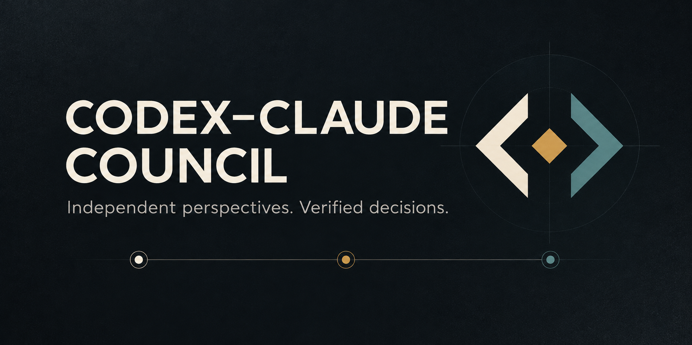
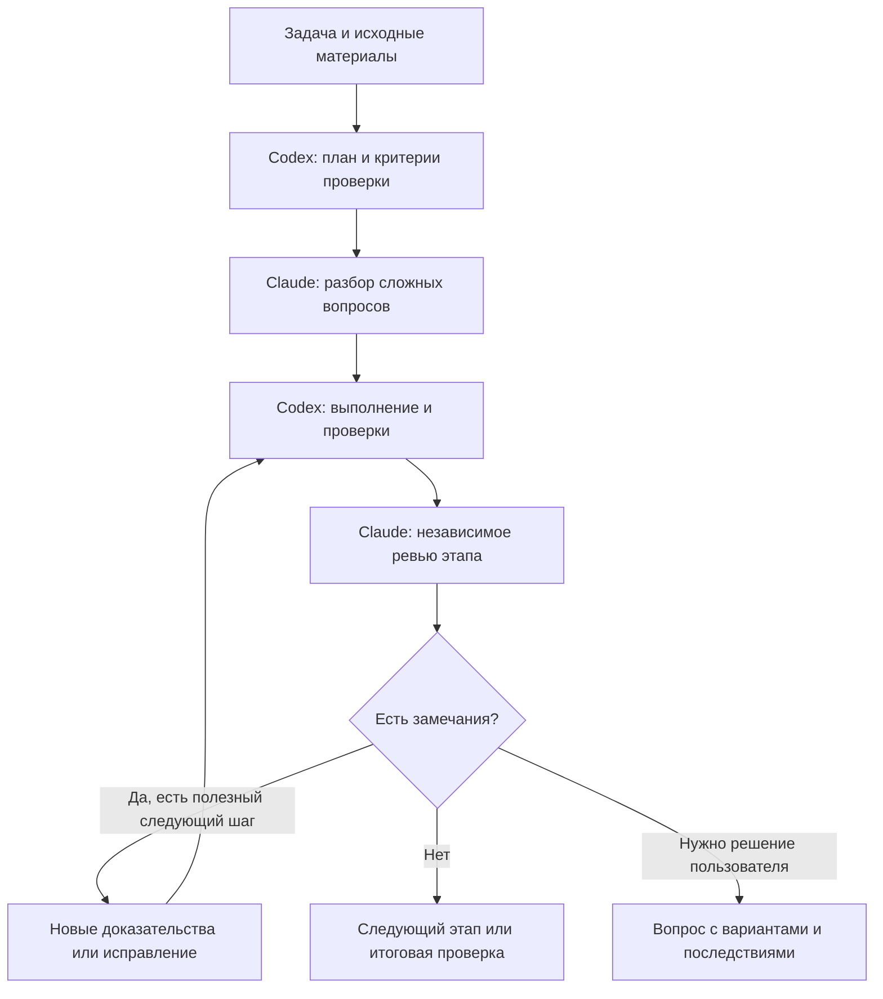

# Codex–Claude Council

Codex ведёт работу, Claude независимо разбирает сложные вопросы и проверяет результат. Выводы опираются на исходные материалы и выполненные проверки.

Навык подходит для разработки, поиска причин ошибок и анализа. Он сохраняет требования, замечания, результаты проверок и сессию Claude, чтобы работу можно было продолжить после прерывания.

Независимый проект, не официальный продукт OpenAI или Anthropic.

## Установка

Нужны Codex, установленный Claude Code с работающим входом, Python 3.10+, Git и POSIX-окружение, например macOS или Linux. Нативный Windows не поддерживается. Контроллер использует стандартную библиотеку Python.

```bash
git clone https://github.com/ghYuriy/codex-claude-council.git
python3 codex-claude-council/scripts/install.py
```

Навык устанавливается глобально в `$CODEX_HOME/skills/codex-claude-council` или `~/.codex/skills/codex-claude-council`, если `CODEX_HOME` не задан. Настройки и способ входа в Claude не меняются.

Для обновления клонированного репозитория и установленного навыка:

```bash
git -C codex-claude-council pull --ff-only
python3 codex-claude-council/scripts/install.py --replace
```

Предыдущая версия сохраняется в `skill-backups` рядом с каталогом `skills`.

## Начать работу

Откройте нужный проект в Codex и напишите «подключи Claude как помощника», затем опишите задачу. Явный вызов `$codex-claude-council` тоже доступен, но не обязателен. Копировать навык в каждый проект не нужно.

Пример запроса:

```text
Подключи Claude как помощника.

Исправь ошибку: повторная отправка формы создаёт вторую запись.
Сначала воспроизведите проблему и установите причину. Сохраните данные
и остальное поведение формы. Проверьте повторную отправку, обработку
ошибки и связанные обработчики. Передайте исправление Claude на
независимое ревью. В конце покажите результаты проверок и то,
что осталось неизвестным. Ничего не публикуйте.
```

Codex сам разбивает задачу на проверяемые этапы и шаги, выбирает проверки и конечный бюджет обращений. Ручная настройка внутренних команд не требуется.

[Использование в разных проектах](docs/usage.md): примеры для новой функции, сложной ошибки, анализа и постоянного правила в проекте.

## Как проходит работа



Claude сначала изучает исходные материалы без прежних выводов моделей. Затем Codex и Claude сопоставляют аргументы и проверяют спорные утверждения. Согласие само по себе не считается доказательством. Для простой правки предварительное обсуждение не обязательно; независимое ревью завершает каждый этап.

При существенных изменениях проверяются также связанные вызовы, обработчики и переходы данных. Каждая дополнительная проверка должна отвечать требованию или реальному риску. Подробные правила находятся в [контракте качества](references/quality-contract.md).

По необходимости Codex и Claude проверяют, следует ли вывод из данных, какие скрытые предпосылки влияют на решение и как план может дать сбой в реальных условиях. Сначала проверяется неопределённость, способная изменить подход; работа делится на небольшие части с наблюдаемым результатом. Эти вопросы входят в существующие обсуждения и ревью, без отдельных режимов и обязательных дополнительных обращений.

## Как выглядит результат

Условный пример ответа:

> Исправил повторное создание записи. Причина была в повторном выполнении операции сохранения после сетевой ошибки.
>
> Проверены первая отправка, повтор того же запроса и обработчик уведомлений. Claude проверил исправление и результаты. Поведение внешнего сервиса при реальном сбое сети не воспроизводилось. Обновление пользователям не опубликовано.

`PASSED` означает выполнение согласованных критериев на проверенной версии файлов. Это не гарантия отсутствия любых ошибок или полноты выбранных проверок.

## Продолжить после прерывания

Откройте тот же проект и попросите:

```text
Подключи Claude как помощника и продолжи ранее начатую задачу
исправления повторной отправки формы. Найди сохранённое состояние,
сохрани требования, замечания, сессию Claude и потраченный бюджет.
Не начинай задачу заново.
```

Состояние хранится вне проекта, по умолчанию в `$HOME/.local/state/codex-claude-council`. Codex находит прежнюю запись и продолжает сохранённую сессию. Если подходящих записей несколько, потребуется выбрать нужную. При переносе проекта на другой компьютер состояние и сессии Claude нужно переносить отдельно; автоматической синхронизации нет.

[Восстановление и решения пользователя](docs/recovery.md) объясняет остановку, восстановление и расширение бюджета.

## Когда потребуется ваше решение

Codex обращается к вам, если нужно изменить требования, разрешить опасное действие, принять существенный риск или увеличить бюджет. Он также уточняет недостающие факты, которые нельзя получить самостоятельно. Автоматическое подключение навыка не предоставляет разрешения на публикацию или другие внешние действия.

Бюджет общий для всей задачи. Обсуждение заканчивается, когда критерии выполнены или нет полезной следующей проверки. Продолжение после прерывания не обнуляет расход.

## Проверки и техническая справка

Из корня клонированного репозитория:

```bash
python3 -B -m unittest discover -s tests -v
```

Эти тесты используют подменный CLI и не обращаются к моделям. Реальное ревью расходует лимит Claude Code.

- [Протокол контроллера](references/protocol.md): команды, состояние и бюджет.
- [Контракт ревью](references/review-contract.md): доказательства и закрытие замечаний.
- [Вызов Claude Code](references/local-transport.md): параметры запуска и совместимость.

Состояние задач может содержать исходные запросы и материалы проекта. Храните его отдельно от публикуемого репозитория. Ограничение инструментов Claude не является изоляцией файловой системы.
