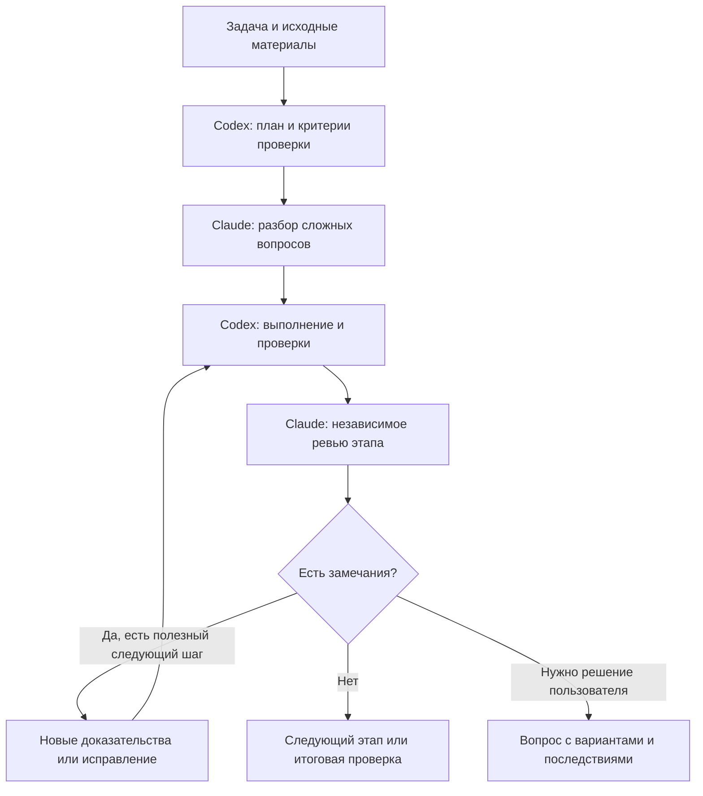

# Codex–Claude Council

Консилиум работает в обе стороны. В Codex ведущим остаётся Codex, а Claude независимо разбирает сложные вопросы и проверяет результат. В Claude Code ведущим остаётся Claude, а встроенный помощник Codex проводит ревью, исследует проблему или выполняет порученное исправление. Выводы опираются на исходные материалы и выполненные проверки.

Навык подходит для разработки, поиска причин ошибок и анализа. Режим с ведущим Codex сохраняет требования, замечания, результаты проверок и сессию Claude в контроллере. Режим с ведущим Claude сохраняет задания и сессии Codex через встроенный runtime. У этих режимов разные механизмы хранения и приёмки, описанные ниже.

Независимый проект, не официальный продукт OpenAI или Anthropic.

## Установка в Codex

Нужны Codex, установленный Claude Code с работающим входом, Python 3.10+, Git и POSIX-окружение, например macOS или Linux. Нативный Windows не поддерживается. Контроллер использует стандартную библиотеку Python.

```bash
git clone https://github.com/ghYuriy/codex-claude-council.git
python3 codex-claude-council/scripts/install.py
```

Навык устанавливается глобально в `$CODEX_HOME/skills/codex-claude-council` или `~/.codex/skills/codex-claude-council`, если `CODEX_HOME` не задан. Настройки и способ входа в Claude не меняются.

Для обновления клонированного репозитория и установленного навыка:

```bash
git -C codex-claude-council pull --ff-only
python3 codex-claude-council/scripts/install.py --replace
```

Предыдущая версия сохраняется в `skill-backups` рядом с каталогом `skills`.

## Установка в Claude Code

Нужны установленный и настроенный Codex CLI, Git и Node.js 18.18 или новее. Отдельный плагин-помощник устанавливать не нужно: все его рабочие компоненты включены в этот репозиторий.

В Claude Code выполните:

```text
/plugin marketplace add ghYuriy/codex-claude-council
/plugin install codex-claude-council@codex-claude-council
/reload-plugins
/codex-claude-council:setup
```

Для обновления:

```text
/plugin marketplace update codex-claude-council
/plugin update codex-claude-council@codex-claude-council
/reload-plugins
```

Используется существующий вход и настройки Codex. Установка не меняет модель и не включает автоматическое ревью при завершении ответа. Если прежний отдельный плагин Codex тоже включён, отключите его после проверки встроенного режима, чтобы не дублировать команды и обработчики сессий. Его данные удалять не требуется.

## Начать работу в Claude Code

Откройте нужный проект и напишите:

```text
Подключи Codex как помощника. Найдите причину повторного создания записи,
исправьте её в пределах текущей задачи и проверьте связанные обработчики.
Сохраните данные и остальное поведение. Ничего не публикуйте.
```

Claude сам выбирает полезное обращение. Анализ и ревью используют режим без записи. Правки Codex разрешены только в рамках уже порученной реализации; Claude проверяет фактические изменения и результаты тестов. Одновременно изменять одни файлы обе модели не должны.

Все команды доступны и отдельно:

| Команда | Назначение |
| --- | --- |
| `/codex-claude-council:setup` | Проверить доступность и вход в Codex |
| `/codex-claude-council:review` | Независимое ревью текущих изменений или ветки с `--base main` |
| `/codex-claude-council:adversarial-review` | Проверить выбранный подход, предпосылки и возможные причины провала; можно добавить тему проверки |
| `/codex-claude-council:rescue` | Поручить исследование или исправление; `--resume` продолжает прежнюю задачу, `--fresh` начинает новую |
| `/codex-claude-council:status` | Показать состояние заданий |
| `/codex-claude-council:result` | Получить полный сохранённый результат |
| `/codex-claude-council:cancel` | Остановить выбранное фоновое задание |
| `/codex-claude-council:transfer` | Перенести текущий разговор Claude в продолжимую сессию Codex |

Ревью и поручения поддерживают `--wait` и `--background`. Модель и уровень рассуждения остаются текущими, если пользователь не выбрал другие. Отдельный запрос на ревью не разрешает исправлять файлы.

Перенос разговора использует настоящий журнал Claude и требует версии Codex с поддержкой импорта. Он выполняется только по запросу пользователя. При отсутствии поддержки команда сообщает об этом.

Необязательная проверка при завершении ответа включается командой `/codex-claude-council:setup --enable-review-gate`, выключается с `--disable-review-gate`. По умолчанию она выключена. Она может запускать длительные повторные обращения и не имеет общего бюджета исходного контроллера.

Данные заданий хранятся вне проекта в каталоге данных плагина Claude. При завершении сессии её фоновые задания останавливаются, временные записи удаляются. Сохранённую сессию задачи Codex можно продолжить по её ID; нужные отчёты следует сохранить до завершения Claude. При прямом запуске runtime вне плагина хранилище временное. `completed` в этом режиме означает завершение вызова, а не прохождение всех критериев задачи.

[Правила работы ведущего Claude](references/claude-lead.md) описывают выбор команды, проверку результата и продолжение задачи.

## Начать работу в Codex

Откройте нужный проект в Codex и напишите «подключи Claude как помощника», затем опишите задачу. Явный вызов `$codex-claude-council` тоже доступен, но не обязателен. Копировать навык в каждый проект не нужно.

Пример запроса:

```text
Подключи Claude как помощника.

Исправь ошибку: повторная отправка формы создаёт вторую запись.
Сначала воспроизведите проблему и установите причину. Сохраните данные
и остальное поведение формы. Проверьте повторную отправку, обработку
ошибки и связанные обработчики. Передайте исправление Claude на
независимое ревью. В конце покажите результаты проверок и то,
что осталось неизвестным. Ничего не публикуйте.
```

Codex сам разбивает задачу на проверяемые этапы и шаги, выбирает проверки и конечный бюджет обращений. Ручная настройка внутренних команд не требуется.

[Использование в разных проектах](docs/usage.md): примеры для новой функции, сложной ошибки, анализа и постоянного правила в проекте.

## Как проходит работа с ведущим Codex



Claude сначала изучает исходные материалы без прежних выводов моделей. Затем Codex и Claude сопоставляют аргументы и проверяют спорные утверждения. Согласие само по себе не считается доказательством. Для простой правки предварительное обсуждение не обязательно; независимое ревью завершает каждый этап.

При существенных изменениях проверяются также связанные вызовы, обработчики и переходы данных. Каждая дополнительная проверка должна отвечать требованию или реальному риску. Подробные правила находятся в [контракте качества](references/quality-contract.md).

По необходимости Codex и Claude проверяют, следует ли вывод из данных, какие скрытые предпосылки влияют на решение и как план может дать сбой в реальных условиях. Сначала проверяется неопределённость, способная изменить подход; работа делится на небольшие части с наблюдаемым результатом. Эти вопросы входят в существующие обсуждения и ревью, без отдельных режимов и обязательных дополнительных обращений.

## Как выглядит результат в Codex

Условный пример ответа:

> Исправил повторное создание записи. Причина была в повторном выполнении операции сохранения после сетевой ошибки.
>
> Проверены первая отправка, повтор того же запроса и обработчик уведомлений. Claude проверил исправление и результаты. Поведение внешнего сервиса при реальном сбое сети не воспроизводилось. Обновление пользователям не опубликовано.

`PASSED` означает выполнение согласованных критериев на проверенной версии файлов. Это не гарантия отсутствия любых ошибок или полноты выбранных проверок.

## Продолжить задачу контроллера после прерывания

Откройте тот же проект и попросите:

```text
Подключи Claude как помощника и продолжи ранее начатую задачу
исправления повторной отправки формы. Найди сохранённое состояние,
сохрани требования, замечания, сессию Claude и потраченный бюджет.
Не начинай задачу заново.
```

Состояние хранится вне проекта, по умолчанию в `$HOME/.local/state/codex-claude-council`. Codex находит прежнюю запись и продолжает сохранённую сессию. Если подходящих записей несколько, потребуется выбрать нужную. При переносе проекта на другой компьютер состояние и сессии Claude нужно переносить отдельно; автоматической синхронизации нет.

[Восстановление и решения пользователя](docs/recovery.md) объясняет остановку, восстановление и расширение бюджета.

## Когда потребуется ваше решение

Codex обращается к вам, если нужно изменить требования, разрешить опасное действие, принять существенный риск или увеличить бюджет. Он также уточняет недостающие факты, которые нельзя получить самостоятельно. Автоматическое подключение навыка не предоставляет разрешения на публикацию или другие внешние действия.

В режиме с ведущим Codex бюджет общий для всей задачи. Обсуждение заканчивается, когда критерии выполнены или нет полезной следующей проверки. Продолжение после прерывания не обнуляет расход. Обратный режим не выдаёт свои результаты за `PASSED` этого контроллера.

## Проверки и техническая справка

Из корня клонированного репозитория:

```bash
python3 -B -m unittest discover -s tests -v
node --test reverse/tests/*.test.mjs
claude plugin validate .
```

Автоматические тесты используют подменные CLI и не обращаются к моделям. Проверка манифеста требует установленного Claude Code. Реальная работа помощника расходует лимит соответствующей модели.

- [Протокол контроллера](references/protocol.md): команды, состояние и бюджет.
- [Контракт ревью](references/review-contract.md): доказательства и закрытие замечаний.
- [Вызов Claude Code](references/local-transport.md): параметры запуска и совместимость.

Состояние задач может содержать исходные запросы и материалы проекта. Храните его отдельно от публикуемого репозитория. Ограничение инструментов Claude не является изоляцией файловой системы.

Лицензия и обязательные уведомления встроенного компонента находятся в [reverse/LICENSE](reverse/LICENSE) и [reverse/NOTICE](reverse/NOTICE).
